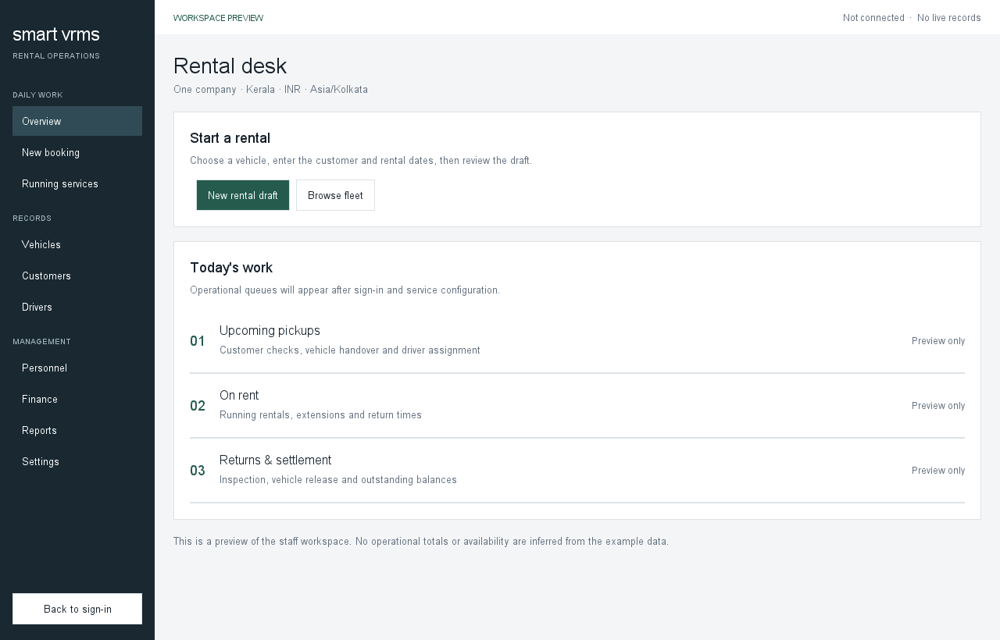

<div align="center">

# Smart VRMS
### A native workspace for vehicle rental operations


[Download Windows Prototype](https://github.com/AshikMadhu/Smart_VRMS/releases/tag/v0.1.2-preview) · [Release Audit](docs/Release-Audit.md) · [Release Manifest](docs/Release-Manifest.md) · [Requirements](planning/Requirements-and-Verification.csv)

</div>



Smart VRMS is a Java 17 and Swing rental-management application with a Java REST API and Supabase Auth/PostgreSQL backend. The currently published Windows package and the newer, unpublished source checkout are at different stages; read the status below before using either for live business work.

> **Latest published download: 0.1.2-preview.** The operator confirmed packaged staff sign-in and live Fleet reads. This proves neither live business writes nor the full rental lifecycle. The local source has additional service/UI work and fixture-based checks, but those changes are not in the published ZIP and have not passed live database/provider journeys. Do not use this preview as a complete production rental system. See [current progress](docs/Business-Prototype-Progress.md), [release audit](docs/Release-Audit.md), and the [90-requirement tracker](planning/Requirements-and-Verification.csv).

---

## 1. Prerequisites

### For End Users (Running the Application)
- **Operating System**: 64-bit Windows 10 or Windows 11 (x64).
- **Hardware**: 4 GB RAM minimum, 100 MB free disk space, 1024x720 minimum display resolution.
- **Java Runtime**: **Zero setup required.** A trimmed OpenJDK 17 runtime is bundled directly inside the application folder via `jlink`. You do **not** need to install Java, Maven, or Git.

### For Developers and System Operators (Building from Source)
- **JDK**: OpenJDK 17 or Eclipse Temurin 17.
- **Build Tool**: Apache Maven 3.8+.
- **Shell**: Windows PowerShell (or Bash on macOS/Linux).

---

## 2. Download and Installation

1. Open the [latest published preview release](https://github.com/AshikMadhu/Smart_VRMS/releases/tag/v0.1.2-preview). This is the most recent published package, not the current local source checkout.
2. Download **`SmartVRMS-Windows-x64.zip`** (approx. 31.9 MB) and optionally **`SHA256SUMS.txt`**.
3. *(Optional but recommended)* Verify file integrity in PowerShell:
   ```powershell
   (Get-FileHash .\SmartVRMS-Windows-x64.zip).Hash -eq (Get-Content .\SHA256SUMS.txt).Split(' ')[0]
   # Should return True (SHA256: 7C93EAAE9067130DADD81BB3EA12F7F7B5D95A95BE1FCB65A4CD82F1369C93E3)
   ```
4. Extract the **entire ZIP archive** into a permanent local directory (e.g., `C:\SmartVRMS` or `%USERPROFILE%\SmartVRMS`).
   *(Do NOT attempt to run `SmartVRMS.exe` directly from inside the compressed zip file without extracting; the bundled `runtime/` folder must be beside it).*
5. Open the extracted folder and double-click **`SmartVRMS.exe`**.

---

## 3. Publisher Trust & SmartScreen Warning (Honest Disclosure)

> [!NOTE]
> **Why does Windows SmartScreen appear?**
> The preview package is **unsigned**. Commercial EV (Extended Validation) code-signing certificates require paid corporate registration. As a free transparent prototype, this binary is not digitally signed.

When you launch `SmartVRMS.exe` for the first time:
1. Windows Defender SmartScreen may display:
   *"Windows protected your PC: Microsoft Defender SmartScreen prevented an unrecognized app from starting."*
2. Click **"More info"**.
3. Click the **"Run anyway"** button.

**macOS & Linux Status (Gate G6 Compliance):**
- Packaging scripts (`scripts/package-desktop-macos.sh` and `scripts/package-desktop-linux.sh`) are included in the source repository.
- Packages have **not** been built or tested on native macOS or Linux runners. Per Gate G6, they are honestly labeled as `PENDING RUNNER`.
- On macOS, Gatekeeper will report *"SmartVRMS cannot be opened because it is from an unidentified developer"*. (Right-click -> Open -> Open).

---

## 4. First Login & Administrator Provisioning

**Downloading the desktop application does NOT automatically create a user account.** Public registration is disabled for enterprise security.

1. **Initial Administrator Setup (Operator Action)**:
   - The system operator provisions the first administrator using the approved setup procedure in the [Operator Guide](docs/Operator-and-Deployment-Guide.md) and the actual migration files under `database/migrations/`. Do not run old migrations again.
2. **First Login**:
   - Launch Smart VRMS.
   - Enter your invited administrator email address and password.
   - Click **Sign In**.
3. **Inviting Additional Staff**:
   - Staff invitation requires a real Supabase Auth Admin integration and a server-only privileged credential. It has not received live acceptance. Do not assume the button successfully creates an Auth account unless the operator confirms the invitation email was received and the user can sign in.

---

## 5. Backend Availability & Free-Tier Wake-Up Latency

The published 0.1.2-preview connects over HTTPS to the Java API (`https://smart-vrms.onrender.com` by default).

> [!IMPORTANT]
> **Free host availability:**
> The current free web-service plan may sleep or be paused, so the API may be delayed or unavailable. Wait for the connection status to finish and retry if needed. Hosting limits can change; do not rely on a fixed wake-up time or service-level guarantee.

You can monitor backend health at any time by visiting `https://smart-vrms.onrender.com/health` in your web browser.

---

## 6. Upgrades & Safe Uninstall

### Upgrading to a Newer Version
1. Download the new versioned ZIP archive from GitHub Releases.
2. Close your running instance of Smart VRMS.
3. Extract the new ZIP archive over your existing folder or into a new directory.
4. Launch the new `SmartVRMS.exe`.
5. **Configuration Persistence**: Your public API endpoint settings are stored in `%LOCALAPPDATA%\SmartVRMS\config.properties` (outside the application directory). Upgrading will **never** overwrite or erase your saved connection settings.
6. **Session Security**: Session tokens are held strictly in memory and are never written to disk. You simply sign in again after launching the new version.

### Safe Uninstallation
To completely uninstall Smart VRMS:
1. Delete the extracted `SmartVRMS` application directory.
2. *(Optional)* Delete `%LOCALAPPDATA%\SmartVRMS` to remove stored connection preferences.
No background services, drivers, or Windows registry keys are left behind.

---

## 7. Update Notifications

The current source contains a non-silent update checker that reads the public GitHub Releases feed, including preview releases:
- If a newer published release is detected, the status button updates to **"Update available — download"**.
- Clicking the button displays a confirmation dialog: *"A newer version is available. Open its official download page?"*.
- Upon your explicit approval, your system default browser opens the official GitHub release page.
- **The application never silently downloads or executes updates in the background.**
The published 0.1.2-preview package predates this current source update-checker change.

---

## 8. Configuration & Security Notes

- **Public API URL Only**: The desktop client only requires the public HTTPS URL of your Java REST API (configured via the **Connection settings** button).
- **Zero Secrets Distributed**: The client application bundle contains **zero** database passwords, **zero** Supabase service-role keys, **zero** private certificates, and **zero** server classes.
- **Transport Security**: All network communications require TLS 1.3 / HTTPS. Local unencrypted HTTP is strictly permitted only for `127.0.0.1` loopback development.

---

## 9. Troubleshooting Guide

| Symptom | Cause | Solution |
| :--- | :--- | :--- |
| **"Windows protected your PC"** | Unsigned application binary. | Click **"More info"** then click **"Run anyway"**. |
| **Spinner runs for ~60s on first login** | Free Render backend waking from idle sleep. | Normal behavior on free tier; wait for container to wake up. |
| **"Could not connect to API server"** | Invalid URL or no internet connection. | Click **Connection settings**, verify URL starts with `https://`, and ensure `/health` resolves. |
| **"Invalid login credentials"** | Account not yet invited or password incorrect. | Contact your administrator to ensure your email has been invited. |
| **Application fails to launch / missing runtime** | Executed directly from inside ZIP file. | Extract the **entire ZIP** to a local folder before running `SmartVRMS.exe`. |
| **Offline launch / No network** | Network disconnected. | The application opens in offline preview mode without crashing. Connect to internet to sign in. |

---

## 10. Architecture & Build Instructions

```text
Swing Desktop (Java 17) ──[HTTPS / REST]──> Java API Server (Render) ──[JDBC Pool]──> Supabase PostgreSQL / Storage
(Contracts + App + Desktop)                   (Auth / Finance / Operations)            (Row Level Security / Audit)
```

| Module | Responsibility |
|---|---|
| `contracts` | Shared immutable records, domain enums, and API request/response models. |
| `application` | Inbound/outbound ports, validation rules, and business capabilities. |
| `desktop` | Native Swing UI, background workers, and REST client adapters. |
| `server` | HTTP routes, Supabase Auth validation, JDBC services and PDF/QR generation. Outbox persistence exists, but a scheduled worker and real email sender are not configured. |

### Building and Verifying from Source
Requires JDK 17 and Maven 3.8+:

```powershell
# Clone repository
git clone https://github.com/AshikMadhu/Smart_VRMS.git
Set-Location Smart_VRMS

# Compile and package all Maven modules
mvn -B package

# Run offline reactor checks and local fixture/regression verification (not live provider acceptance)
powershell -ExecutionPolicy Bypass -File .\scripts\verify.ps1

# Launch local desktop preview
powershell -ExecutionPolicy Bypass -File .\scripts\run-preview.ps1

# Rebuild Windows x64 native package (requires WiX / jpackage)
powershell -ExecutionPolicy Bypass -File .\scripts\package-desktop-windows.ps1
```

---

## 11. Documentation Index

- [Stage 10 Traceability Matrix (90 Requirements)](docs/Stage-10-Traceability-Matrix.md)
- [Release Audit & Historical Evidence](docs/Release-Audit.md)
- [Release Manifest & Exact Checksums](docs/Release-Manifest.md)
- [User Guide](docs/User-Guide.md)
- [Developer Guide](docs/Developer-Guide.md)
- [Operator & Deployment Guide](docs/Operator-and-Deployment-Guide.md)
- [Third-Party Notices & Licenses](docs/Third-Party-Notices.md)
- [Delivery Checklist](docs/Delivery-Checklist.csv)

Source code availability does not imply an unencumbered license. Third-party software components retain their respective open-source licenses (see [Third-Party Notices](docs/Third-Party-Notices.md)).
