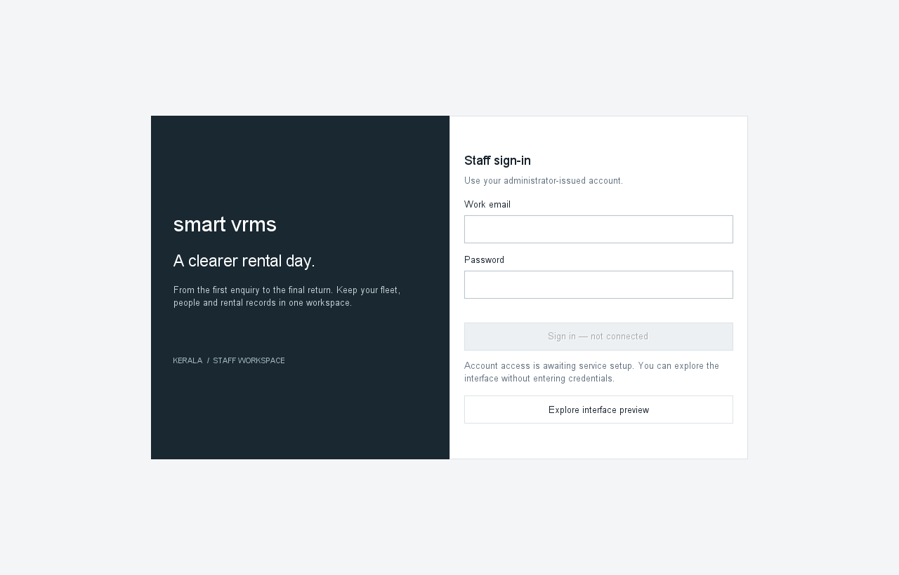

# User guide — 0.1.1-preview

This is a read-only interface preview. Examples are fictional. It cannot yet be used to record real bookings, payments, custody changes or staff records. See Release-Audit.md for current limitations.

## Open the preview

Download SmartVRMS-Windows-x64.zip from the versioned GitHub preview release, extract the entire archive, and open SmartVRMS/SmartVRMS.exe. Java is bundled. Windows 11 x64 is the tested target; the package is unsigned.

Choose Explore interface preview to view layouts without entering credentials. Staff sign-in requires a running operator-configured Java API and an invited account. Supabase's project URL is not the Java API URL. There is no deployed backend in this release.

## Explore

- Vehicles: browse fictional gallery/detail examples and carry a vehicle into a local draft.
- New booking: enter local customer/contact/date fields, review the draft and edit it. Confirm booking stays unavailable.
- Running services, customers, drivers, personnel, finance and reports: fictional examples, labelled as preview. Unconnected actions are disabled; no changes are persisted.
- Connection settings: save the operator's public HTTPS Java API endpoint and restart. Do not enter an API key or password in that field.

## Updates

The app checks for a newer stable GitHub release in the background. Check for updates also runs on demand. When an update exists, confirm opening its official download page, download/extract the new archive, close the old version and launch the new one. The public endpoint is stored outside the installed folder. Staff sessions are memory-only.

No new stable release is available merely because code was pushed. Maintainers must build and publish it. Preview releases are labelled separately and do not appear as the latest stable version.

## Problems

If sign-in is unavailable, use the interface preview; ask the operator for the configured API rather than entering Supabase credentials at random. A failed operation must not be treated as a successful save or payment. Report app version, the action, and sanitized error text. Do not include passwords, session tokens, customer identity documents or payment credentials in a public issue.
